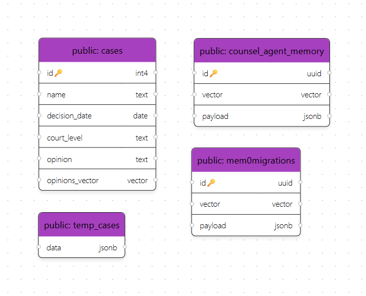
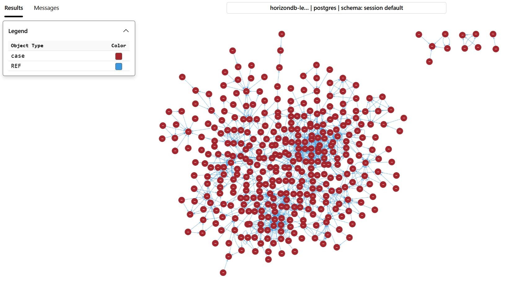
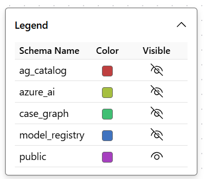
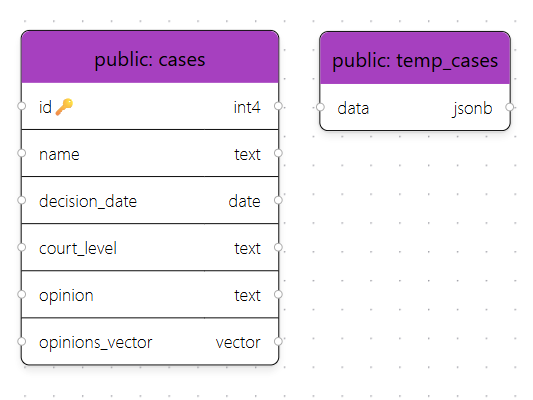
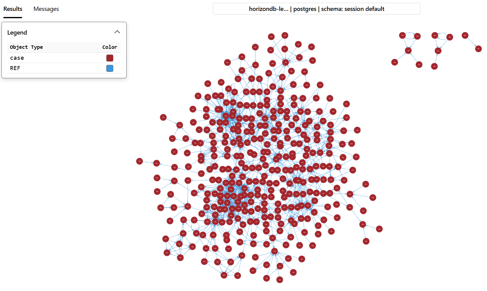

# Part 2 - Prepare the data for your AI assistant

## 2.1 Prepare the case data

You will load a sample of Washington State court cases into Azure HorizonDB. The assistant will search these cases by keyword, by meaning, and through citations between cases.

1. In VS Code, select **Explorer** on the left.

    

2. Expand the `Code` folder and open `1-data-setup.ipynb`.

    

3. Keep this instruction page open alongside the notebook.

### Run the cells

Start at the top of the notebook. Select the **Run Cell** play button beside each code cell, one at a time, and wait for it to finish. Skip any text-only cells.

Follow the sections below in order; each run step moves to the next code cell. If a cell reports an error, stop and ask your facilitator for help.

## 2.2 Load the Python libraries

The libraries connect the notebook to HorizonDB and Azure OpenAI.

1. Run **the first code cell**.
2. When VS Code asks for an environment, select **Python Environments** > **Python 3.13.9**, not **Python 3.14.7**. If a different kernel is already selected, click its name at the top right to change it.
3. Wait for the cell to finish without an error. No printed output is expected.

    The packages are already installed. If you see `ModuleNotFoundError`, check that you selected Python 3.13.9.

## 2.3 Read the connection settings

The notebook reads the prepared `.env` file. The chat model will write answers, and the embedding model will prepare text for meaning-based search.

1. Run **the next code cell**.
2. Check that three values print: the chat deployment name, embedding deployment name, and API version.

    If you see `KeyError`, a required setting is missing. Ask your facilitator for help and keep keys and passwords out of shared error messages.

## 2.4 Enable the database capabilities

PostgreSQL extensions add the search, graph, and AI capabilities used in this lab.

1. Run **the next code cell**.
2. Check for five extension-ready messages followed by `Done. Extensions Created.`

    If an extension fails to load, ask your facilitator for help. The [optional diagnostics exercise](optional-diagnostics.md) checks a server setting used by keyword search.

## 2.5 Register the AI models

This step gives the database two short names for the Azure OpenAI models. The model registry stores each model's endpoint and connection details so SQL calls can use an alias instead of supplying credentials each time.

1. Run **the next code cell**.
2. Check that `lab-chat` and `lab-embedding` are registered and appear in the verification rows.

    The assistant will use `lab-chat` later to extract facts from case opinions.

## 2.6 Load the court cases

The dataset is at `C:\Lab\Dataset\cases.csv`. This step loads it into searchable tables.

The `cases` table holds the case names, dates, courts, and opinion text used by the assistant. The `temp_cases` table keeps the raw records, including the citations used to build the graph later.

> [!WARNING]
> This step deletes and recreates the `cases` and `temp_cases` tables. Use only the database created for this lab.

1. Run **the next code cell**.
2. Check that `CSV path:` points to the dataset above.
3. Wait for `Done. <N> cases loaded into the cases table.` The count must be greater than zero. Note the count for the graph check later.

    Allow around 30 to 60 seconds. If the cell cannot find the file, ask your facilitator to check the printed path.

## 2.7 Check the loaded cases

1. Run **the next code cell**.
2. Check that five case rows print. Find a case name, date, court, and opinion text.

    The data model shows those fields.

    

## 2.8 Add storage for meaning-based search

An embedding is a list of numbers that represents text for similarity comparisons. This step adds a column to store one for each case. Its size matches the prepared embedding model.

1. Run **the next code cell**.
2. Check for `opinions_vector column added.`

## 2.9 Generate the embeddings

Azure OpenAI converts case text into embeddings and the notebook saves them in HorizonDB.

1. Run **the next code cell**.
2. Watch the progress messages. Wait for 100% and `Done. <N> rows processed.`

    Allow several minutes.

    For this lab, each embedding uses the case name and up to the first 8,000 characters of the opinion. Later passages in longer opinions are not represented.

    > [!NOTE]
    > Rerunning this cell clears existing embeddings and starts again. If it is interrupted, ask your facilitator for help before retrying.

## 2.10 Build the citation graph

A citation is a reference from one case to another. This step rebuilds the lab's citation graph, with a point for each case and a link for each citation within the dataset.

Citations to cases outside the sample are not included.

1. Run **the next code cell**.
2. Compare `Node count:` with the case count you noted during data loading. They should match.
3. Wait for `Done. Case graph is ready.` Creating the links can take several minutes.

    

## 2.11 Build and test keyword search

This step prepares keyword search and tries the sample query `water leaking`. It searches the opinion text, not the case names.

1. Run **the next code cell**.
2. Check for `pg_textsearch extension is ready.` and up to five case matches under `Top matches`.

    The BM25 score ranks keyword matches. Lower, more negative scores are stronger matches for this query, not confidence percentages.

    This keyword search does not support exact-phrase or typo-tolerant queries.

## 2.12 Build the meaning-based search index

DiskANN uses approximate matching to speed up searches over large collections of embeddings.

1. Run **the next code cell**.
2. Wait for `pg_diskann ready: idx_cases_diskann`. This can take a couple of minutes.

## 2.13 View the tables and citation graph

Use the VS Code PostgreSQL extension for these steps. There is no additional notebook cell.

### View the tables

1. Select the **PostgreSQL** elephant icon on the left.
2. Expand the `lab` connection.
3. Right-click the `postgres` database and select **Visualize Schema**.
4. Use the eye icon to hide schemas other than `public`.

    

5. Find `cases` and check that it has an `opinions_vector` column.

    

### View the citation graph

1. Right-click `postgres` and select **New Query**.
2. Copy the query below into the editor. It is also in `C:\Lab392\Code\show_graph.sql`.

    ```sql
    SET search_path = public, ag_catalog, "$user";

    SELECT * FROM cypher('case_graph', $$
        MATCH (n)-[r]->(m)
        RETURN n, r, m
    $$) AS (source agtype, edge agtype, target agtype);
    ```

3. Select the query editor's **Run** play button.
4. Open the graph view in the results and inspect the cases and their citation links.

    

Continue to [Part 3 - Build and try the AI assistant](part-3-agentic-app-development.md).
