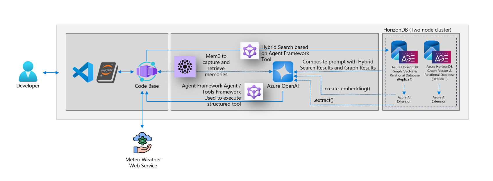
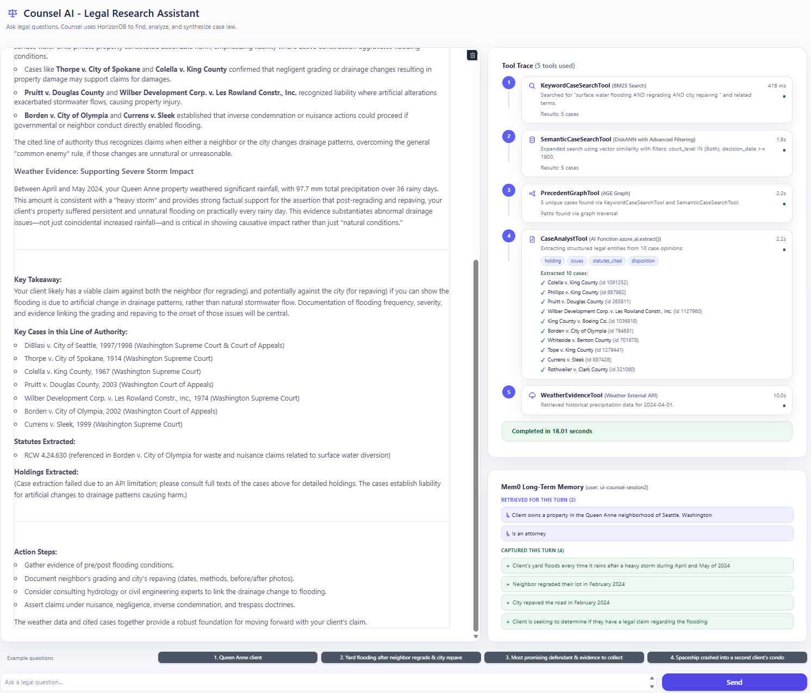
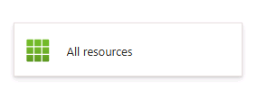
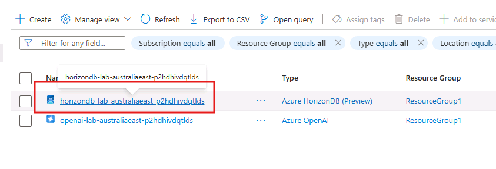
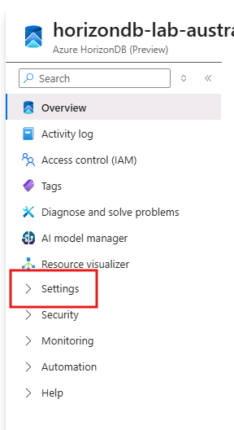
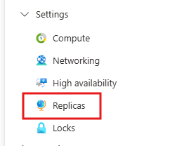
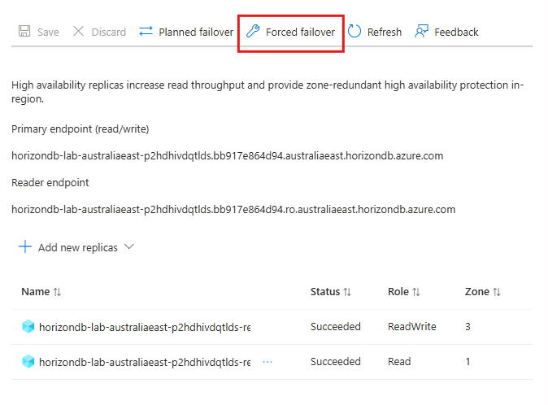

# Part 3 - Build and try the AI assistant

## 3.1 Understand what you will build

You will build Counsel AI, a legal research assistant for a sample property-flooding dispute in Seattle. It will search the cases you loaded, follow citation links, extract facts, and request historical rainfall data when relevant.

An agent is an AI assistant that can call tools to gather information before answering. Here, a tool is a prepared function with a specific job, such as searching cases. Microsoft Agent Framework connects the tools to the Azure OpenAI chat model.

| Tool | What it contributes to the answer |
|---|---|
| `keyword_case_search` | Cases containing relevant legal terms. |
| `semantic_case_search` | Cases about similar situations, even with different wording. |
| `precedent_graph_search` | Related decisions connected through citations. |
| `case_analyst_extract` | Structured facts from case opinion text. |
| `get_weather_evidence` | Historical rainfall records from an external service. |

The assistant will also store selected conversation facts in HorizonDB using Mem0, a memory library. You will try this through a browser-based chat app built with Gradio.



> [!IMPORTANT]
> This is a learning application, not legal advice or a production-ready service. The lab uses a sample dataset and shortened opinion text. An answer that sounds convincing can still be incomplete or wrong. Check the source evidence, tool results, and any reported errors.

### Open Notebook 2

Complete [Part 2](part-2-data-setup.md) first. Its database tables, embeddings, citation graph, indexes, and registered models must be ready.

1. In VS Code Explorer, open `C:\Lab392\Code\2-app-development.ipynb` on the guided VM, or `src/2-app-development.ipynb` on your own computer.
2. If a kernel is already selected at the top right, confirm that it is **Python 3.13.9** on the guided VM. To change it, select the kernel name, then **Python Environments** > **Python 3.13.9**. On your own computer, use the `.venv` environment from setup.
3. Keep this page open alongside the notebook.


### How to follow this notebook

**Count code cells only, starting at the top of Notebook 2.** Do not count markdown cells or use VS Code's execution counters as cell positions. Select **Run Cell** for each cell and wait for it to finish before proceeding. Do not use **Run All**.

Some cells only define tools. They finish without printed output because they are preparing a capability, not using it yet. Later cells test the tools or let the agent call them.

| Code cell | Purpose | Code to look for |
|---|---|---|
| 1 | Load the application libraries | `import nest_asyncio` |
| 2 | Read connection settings | `load_dotenv(override=True)` |
| 3 | Define keyword search | `def keyword_case_search` |
| 4 | Test keyword search directly | `// Test Call of keyword_case_search //` |
| 5 | Run the first agent | An agent with only `keyword_case_search` in its tools list. |
| 6 | Define meaning-based search | `VALID_COURT_LEVELS` and `def semantic_case_search` |
| 7 | Compare the two searches directly | `Tool 1 ids`, `Tool 2 ids`, and `Union  ids` print statements. |
| 8 | Run the two-tool agent | An agent with keyword and semantic search in its tools list. |
| 9 | Define citation-graph search | `def precedent_graph_search` |
| 10 | Test the three search tools directly | `graph_out = precedent_graph_search` |
| 11 | Run the three-tool agent | An agent whose tools list now includes `precedent_graph_search`. |
| 12 | Define structured fact extraction | `def case_analyst_extract` |
| 13 | Run the four-tool agent | An agent whose tools list now includes `case_analyst_extract`. |
| 14 | Define historical weather lookup | `def get_weather_evidence` |
| 15 | Test weather lookup directly | `weather_out = get_weather_evidence` |
| 16 | Run the five-tool agent | An agent whose tools list now includes `get_weather_evidence`. |
| 17 | Set up stored memory | `USER_ID = "client-001"` |
| 18 | Start the chat app | `# Counsel AI - Gradio web UI for the full 5-tool + Mem0 agent` |

During an agent run, lines such as `keyword_case_search was called` show which tools the agent invoked. They are evidence of tool use, not a guarantee that the final answer is correct. Generated answers and tool-call order can vary between runs.

If an expected tool is missing, rerun that agent cell once. If it is still missing, or a tool reports an error, ask your facilitator for help. On your own computer, use the troubleshooting table at the end of this page. Do not treat a fluent answer as proof that a failed step worked.

## 3.1.1 Load the application libraries

These libraries connect the chat model, database tools, memory storage, and browser interface.

1. Run **code cell 1**.
2. On the guided VM, the first time you run a cell without a selected kernel, VS Code asks you to choose a Python environment. Select **Python Environments** > **Python 3.13.9**. The VM also has **Python 3.14.7**; **do not select it for this lab**.
3. Confirm that it finishes without an error. No printed output is expected.

The guided VM already has the packages installed. If you see `ModuleNotFoundError`, confirm the selected kernel. For self-paced setup, return to the [Python environment instructions](../setup/SETUP.md#setup-your-python-environment-and-install-dependencies).

## 3.1.2 Read the connection settings

Notebook 2 has its own Python session, so it must load `.env` again even though Notebook 1 already did so.

1. Run **code cell 2**.
2. Confirm that the printed chat deployment, embedding deployment, and API version match your `.env` settings.

The case tools use the configured HorizonDB connection. Mem0 will also use the configured database to write memories, so your lab credentials must support that write access. If a required setting is missing, the cell reports `KeyError`.

## 3.2 Define keyword search

Keyword search helps when the question contains known terms, such as a legal doctrine or the word "drainage." BM25 ranks matching opinions by their relevance to the terms.

1. Run **code cell 3**.
2. Confirm that it finishes without an error. This cell defines `keyword_case_search`; it does not search yet.

The tool's description tells the agent what the tool does and when to use it. Clear descriptions matter because the model uses them when choosing a tool.

## 3.2.1 Test keyword search without the agent

First, test the search by itself. This separates a database-search problem from an agent's tool-selection problem.

1. Run **code cell 4**.
2. Look for `keyword_case_search was called`.
3. Confirm that the output contains up to five case rows with a case ID, date, court, `score=`, name, and opinion snippet.

For this search, lower, more negative BM25 scores mean stronger keyword matches. Compare scores within this query only. They are not probabilities.

## 3.2.2 Let the agent use keyword search

The sample question describes a Seattle property that floods after the city changes road drainage. Rather than manually entering search terms, you now let the agent choose them and write an answer from the returned cases.

1. Run **code cell 5**.
2. Under `// Functions the Agent Called: //`, look for `keyword_case_search was called`.
3. Read the answer under `// Agent Response: //`.
4. Compare the answer with the raw rows from cell 4. Find a case that the agent names and explains.

The change is from search results to a drafted explanation. A reviewer still needs to check whether the cited cases support that explanation.

## 3.3 Define search by meaning

A person may describe "my yard floods after the road was changed" without knowing the legal terminology. Meaning-based search compares an embedding of that description with the case embeddings prepared in Part 2.

This tool also accepts a court selection and minimum year. Those filters keep the search within the requested scope. DiskANN supports filtering during the similarity search.

1. Run **code cell 6**.
2. Confirm that it finishes without an error. It defines `semantic_case_search` but does not run a search.

`Both` allows both Washington court levels in the sample, and `1900` supplies a broad minimum year. You do not need to change those values for this exercise.

## 3.3.1 Compare keyword and meaning-based results

1. Run **code cell 7**.
2. Find the keyword and semantic result blocks.
3. Compare `Tool 1 ids`, `Tool 2 ids`, and `Union  ids`.
4. Identify cases found by both methods and any cases found by only one.

The union is the combined list with duplicate case IDs removed. Using both search methods is called hybrid retrieval. It can find evidence that either method alone misses.

The semantic result's score is cosine similarity. Values closer to 1 indicate greater similarity to the question. Do not compare that number with a BM25 score or read it as answer confidence.

## 3.3.2 Let the agent use both search tools

1. Run **code cell 8**.
2. Confirm that the trace includes both `keyword_case_search was called` and `semantic_case_search was called`.
3. Compare the answer with the one-tool answer from cell 5.

Look for cases that the meaning-based search contributed. More retrieved cases can broaden the evidence, but do not assume that a longer answer is a better answer.

## 3.4 Define citation-graph search

The first two tools find candidate cases. The graph tool then follows their citations to find related decisions.

It follows links up to two steps away in both directions, including cases the candidates cite and cases that cite them. The lab ranks these related cases and gives Washington Supreme Court decisions an extra ranking weight.

1. Run **code cell 9**.
2. Confirm that it finishes without an error. It defines `precedent_graph_search`.

Citation connections and ranking weights help select material for review. They do not establish that a case is controlling law for every question.

## 3.4.1 Test the three search tools together

1. Run **code cell 10**.
2. Find `Input ids:`. These combine the keyword and meaning-based results.
3. Find `RELATED_CASE_IDS:` in the graph output. These are additional cases, not the original input cases.
4. Compare `related_count_total` with `returned_top_k`. The tool returns at most ten related cases.
5. Inspect a Washington Supreme Court row. Its graph score includes the extra weight of two added to its path count.

A path is a chain of citation links. The path count helps rank connected cases. It is not an AI confidence score. The result limit keeps the next analysis step from receiving every connected opinion.

## 3.4.2 Let the agent use the citation graph

1. Run **code cell 11**.
2. Confirm that all three search tools appear in the trace.
3. Compare the answer with the graph results from cell 10.

Look for a related case that the graph added and check how the answer uses it. The agent is now combining search results with relationships between records.

## 3.5 Define structured fact extraction

Finding an opinion is different from identifying what the court decided. This tool asks Azure OpenAI to extract selected facts through the database's `azure_ai` extension, using the `lab-chat` model registered in Part 2.

| Field | Plain-language meaning |
|---|---|
| `holding` | The court's legal ruling. |
| `issues` | The questions the court considered. |
| `statutes_cited` | Laws mentioned in the opinion. |
| `disposition` | How the court resolved the case. |

1. Run **code cell 12**.
2. Confirm that it finishes without an error. It defines `case_analyst_extract`; extraction runs in the next cell.

The database requests the model analysis, but the text still goes to Azure OpenAI. Keeping the function in the database does not mean the AI processing stays entirely inside the database.

This lab analyzes only the first 1,200 characters of each opinion to limit processing time. Important facts may be outside that excerpt, so the extracted fields need review against the full source.

## 3.5.1 Let the agent extract facts and draft an answer

1. Run **code cell 13**.
2. Confirm that the trace includes the three search tools and `case_analyst_extract was called`.
3. Look for `fields=holding,issues,statutes_cited,disposition` and the `extracted_case=` completion lines.
4. Compare the answer with the three-tool answer from cell 11. Look for court rulings, issues, or statutes rather than case names alone.

The extraction result uses the `CASE_BRIEFS_JSON:` header. JSON is a structured data format with named fields. If the result contains `extraction_failed`, that case's analysis failed even if an `extracted_case=` completion line printed. Do not rely on an answer as if that case was successfully analyzed.

## 3.6 Define the external weather tool

Some relevant facts are outside your database. This tool calls the Open-Meteo archive service for rainfall records at a location and date range.

1. Run **code cell 14**.
2. Confirm that it finishes without an error. It defines `get_weather_evidence`.

The agent should use this tool for weather-related questions, not every legal question. The tool requires coordinates and a start date. It can also accept an end date.

## 3.6.1 Check the weather service directly

1. Run **code cell 15**.
2. Confirm that the output includes `get_weather_evidence was called` and `=== Weather Evidence (pretty) ===`.
3. Check that the result identifies Seattle at latitude `47.6062`, longitude `-122.3321`, and the period January 10 to January 20, 2023.
4. Find `total_precipitation_mm`, `days_with_rain`, and `daily_records`. Each daily record has a `date` and `precipitation_mm`.
5. Identify the day with the highest recorded rainfall.

The current code requests rainfall only. Do not expect temperature fields described in older notebook text.

`WEATHER_EVIDENCE_ERROR` or a no-data message is not a successful weather result. Check outbound access to `archive-api.open-meteo.com` and the reported error before proceeding.

## 3.6.2 Let the agent use all five tools

This example supplies a Seattle flooding question with a February 2024 date, so the agent has a reason to request weather evidence.

1. Run **code cell 16**.
2. Confirm that the trace includes all five tools.
3. Check that the weather call uses Seattle coordinates and dates in February 2024.
4. Compare the answer with the four-tool answer from cell 13. Look for rainfall evidence and how the answer connects it to the legal question.

Rainfall data can support a factual claim that it rained. It does not, by itself, prove what caused the property damage or who is legally responsible.

## 3.7 Set up stored memory

Mem0 saves selected facts from conversations and retrieves relevant ones before a later answer. Its memory table, `counsel_agent_memory`, lives in the same HorizonDB database as the cases.

1. Run **code cell 17** once, without editing it.
2. Find `--- Memories retrieved for this turn ---` and `--- New memories extracted from this turn ---`.
3. Read the intake question and response. On a first run for this demo user, there may be no previous memories.

The current cell has the first intake question active and the remaining example questions commented out. You do not need to change those comments. You will demonstrate all four conversation turns in the chat app next.

Stored memory can reduce repeated intake questions. A business application also needs rules for what to store, who can access it, how to correct it, and when to delete it. The lab's fixed demo user IDs are not a production identity or access-control design.

## 3.8 Start the chat app and try memory

1. Run **code cell 18**.
2. Wait for `Running on local URL: http://127.0.0.1:7860`.
3. Open [http://localhost:7860](http://localhost:7860) in a browser on the computer running the notebook. On the guided lab, that means the browser inside the VM.

The app has a conversation panel, a Tool Trace panel, and a Long-term Memory panel.



> [!NOTE]
> Starting this cell clears the chat app's demo-user memories. It uses a different demo user from cell 17, so the notebook's intake facts do not appear automatically in the app. Do not rerun cell 18 during the conversation below.

### Send four conversation turns

Enter each message in the chat text box and select **Send**. Wait for the answer and memory updates before sending the next message. These are chat messages, not code to paste into a notebook.

1. Send the intake message:

   ```text
   Hi, I am an attorney and my client owns a property in the Queen Anne neighborhood of Seattle, Washington. Please remember those details for later. No legal question yet.
   ```

   Check the Memory panel for the property location.

2. Describe the problem without repeating the location:

   ```text
   After a heavy storm during February of 2024 my client's yard floods every time it rains. Right after the storm, the city regraded the road. Does my client have a claim?
   ```

   Check that the assistant uses the earlier Seattle context. Watch the Tool Trace panel for research and weather calls, and look for new storm or road-work facts in memory.

3. Ask a follow-up:

   ```text
   Given what you found, what evidence should I start collecting?
   ```

   Check that the response refers to the existing flooding problem without asking you to repeat the location and storm date.

4. Check recall:

   ```text
   Remind me what neighborhood my client's property is in, and what was the month of the storm we discussed.
   ```

   Confirm that the answer says Queen Anne and February 2024. This question should be answerable from memory without new case or weather research.

Refresh the browser page, then send the recall question again without reentering the intake messages. The chat display starts a new conversation, but the stored demo-user memories should still supply those facts. Check the Memory panel as well as the answer. Do not restart the notebook cell for this check, because that clears those memories.

The app also has example-question buttons. They fill the text box; you still need to select **Send**. Their weather dates may differ from the four-turn exercise above.

## 3.9 Observe recovery during a database failover

A failover switches the database's primary role to a standby replica. This exercise lets you observe how the app handles a temporary connection interruption.

There is no new notebook cell for this step. Leave the app from cell 18 running.

> [!WARNING]
> Only trigger failover on your isolated lab resource, with your facilitator's approval during a guided session. Never do this on a production or shared business database. If your self-paced deployment has no standby replica or the action is unavailable, you cannot perform this exercise with that configuration.

1. Send a normal chat message first and confirm that the app responds and can retrieve stored memories.
2. Open the [Azure portal](https://portal.azure.com). Guided attendees can use the credentials in the lab's **Resources** tab if they need to sign in again.
3. Select **All Resources**.

   

4. Open your lab HorizonDB resource, named `horizondb-lab-...` in the guided environment. On your own subscription, select the resource deployed for this lab.

   

5. Under **Settings**, select **Replicas**.

   

   

6. Select **Forced Failover** and confirm with **Fail over**.

   

7. Immediately return to the chat app and send a follow-up such as `What other defendants should I consider?`.
8. Inspect cell 18's output for messages such as `Mem0: search attempt 1/5 failed ... Retrying...`. Your request may miss the interruption window, so those messages are not guaranteed.
9. After the portal reports completion, send the recall question again. Confirm that the app responds and retrieves the Queen Anne and February 2024 memories.

The memory lookup retries up to five times with pauses. The case tools generally open a new database connection for each call. These patterns can help recovery, but they do not guarantee that every in-flight request succeeds or that failover is invisible.

If you see `Mem0: search unavailable after 5 attempts, returning no results.`, that turn ran without retrieved memories. Wait for failover to complete and check recall again. An answer without an error is not enough to prove memory recovery.

### Finish the lab

After the recovery exercise, close the app tab and select **Restart Kernel** in Notebook 2 to stop the local app. This clears the notebook's Python variables, not the case records stored in HorizonDB.

You have used one database for case data, multiple search methods, citation links, and conversation memory. The weather records came from an external service, and Azure OpenAI supplied embeddings and generated analysis.

Before applying this pattern to your business, consider which sources the assistant may use, how people will check its answers, and which conversation facts it is allowed to retain.

Notebook 3 is **optional**. Use [the diagnostics guide](optional-diagnostics.md) if you want to inspect a server setting or investigate an extension-loading problem. For further learning, see the [session resources](../README.md#-continue-your-learning), [Microsoft Agent Framework documentation](https://aka.ms/agent-framework), and [Mem0 documentation](https://docs.mem0.ai/).

## Troubleshooting

| What you see | What to check |
|---|---|
| `NameError` | A previous defining cell did not run, or the kernel restarted. Run the prerequisite cells in order before retrying the current one. |
| `KeyError` or a connection error | Check `.env`, the selected kernel, database credentials, and networking from the [setup guide](../setup/SETUP.md). Do not share credentials. |
| Missing tables, indexes, graph, or model alias | Confirm the corresponding Part 2 step finished successfully. Do not rerun all of Part 2, because some cells replace data. |
| No search matches | Check the direct tool test and the loaded cases before trusting the agent's answer. |
| `extraction_failed` | Inspect the result's error reason and confirm that `lab-chat` was registered successfully in Part 2. A completion line alone does not prove successful extraction. |
| `WEATHER_EVIDENCE_ERROR` or no weather data | Check the reported dates, coordinates, and outbound access to the weather service. |
| The app URL does not open | Run cell 18 first, wait for the local URL message, and open the browser on the notebook's computer. Check cell output for startup or port errors. |
| Expected memories are missing | Check the Memory panel and notebook error output. Rerunning cell 18 clears the app's demo memories; reenter the intake turns if you restarted it. |

Guided attendees should ask the facilitator about unresolved errors. Self-paced learners can [open an issue](https://github.com/Jcardif/aitour27-ILL392-build-agentic-ai-postgres-apps-on-azure-horizondb/issues) with the notebook name, code-cell position, and sanitized error text.
